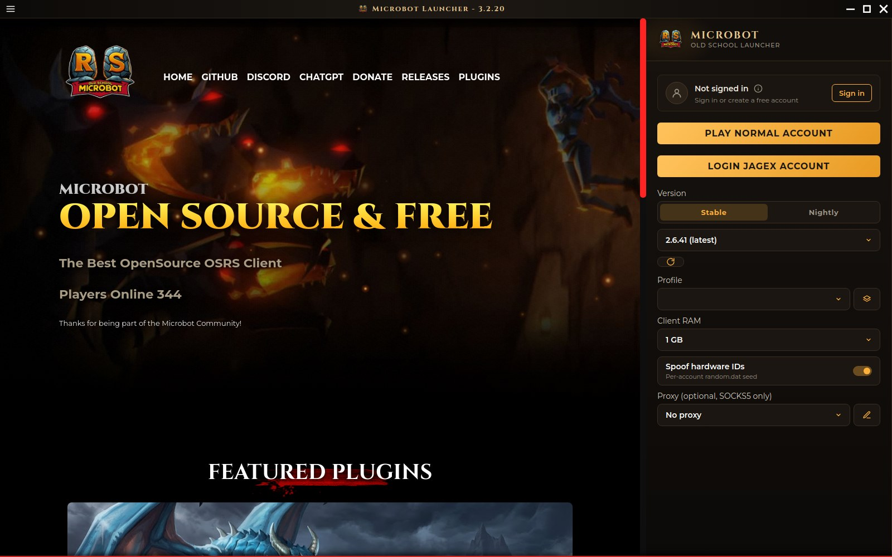

# Microbot Launcher

The desktop launcher for [Microbot](https://themicrobot.com), the open source Old School RuneScape client. It downloads the client, keeps it up to date and starts it with your account, profile, RAM and proxy settings.



## Download

Get the installer for Windows, macOS or Linux from [themicrobot.com](https://themicrobot.com). The launcher updates itself when a new version is out.

## What it does

- **Play with a Jagex account or a normal account.** *Login Jagex account* signs you in through Jagex so you can play your Jagex characters. *Play normal account* opens the client so you can log in with a username and password on the game's login screen.
- **Stable or Nightly.** Stable is the tested release and right for most players. Nightly is built every night from the newest Microbot code: you get fixes sooner, but it is tested less. On Stable, keep the newest version, because older ones stop working after game updates.
- **Profiles.** A profile holds your plugin settings, and each Jagex character remembers its own, so every account can keep its own setup. Sign in with a Microbot account to back your profiles up and use them on another PC.
- **Client RAM.** Choose how much memory the client gets. 1 or 2 GB is enough for one client.
- **Spoof hardware IDs.** On by default. Each account sends its own `random.dat` seed instead of your computer's.
- **Proxies.** Optional, SOCKS5 only. A character you added through a proxy switches back to it when you select it. With a Jagex account, the login window and the launcher's Jagex requests also go through the proxy.
- **Microbot account and dashboard.** Signing in is optional and is not your Jagex account. Once you're signed in, the left pane shows your [Microbot dashboard](https://dashboard.microbot.cloud): your linked clients, what they're running, the XP they're making and your bot alerts.
- **Setup guide.** On first start a short guide explains which account you have and what to check before you play. Open it again from the menu at any time.

The launcher keeps its files in `~/.microbot` (`%USERPROFILE%\.microbot` on Windows). The client logs go to `~/.runelite/logs/client.log`.

## Development

You need [Node.js](https://nodejs.org/) 20 or newer. Electron is installed as a dev dependency, so you don't need it globally.

```bash
git clone https://github.com/chsami/Microbot-Launcher.git
cd Microbot-Launcher
npm ci
npm run dev
```

| Command | What it does |
| --- | --- |
| `npm run dev` | Starts the launcher with debug logging |
| `npm run dev:mock` | Starts it with fake in-memory Microbot accounts (see below) |
| `npm test` | Runs the Jest tests |
| `npm run test:coverage` | Runs the tests with a coverage report in `coverage/` |

### Environment variables

| Variable | Use |
| --- | --- |
| `MICROBOT_API_URL` | Points sign-in at another Microbot API, e.g. a local one |
| `MICROBOT_DASHBOARD_URL` | Shows another dashboard in the left pane after sign-in |
| `MOCK_AUTH=1` | Replaces the real Microbot API with in-memory accounts that reset on restart |
| `MOCK_USERS` | Accounts for mock mode, as JSON (`[{"email":"demo@site.com","password":"Password1"}]`) or `email:password` pairs separated by commas |
| `MOCK_LATENCY_MS` | Delay added to every mock request, in milliseconds |
| `MOCK_FAIL_PCT` | Percentage of mock requests that fail (0-100) |

`npm run dev:mock` sets mock mode with two accounts: `demo@microbot.com` / `DemoPassword123` and `test@example.com` / `TestPassword123`.

### Building installers

```bash
npx electron-builder --win
npm run linux
npm run mac
```

Run each one on the platform it builds for. Installers land in `dist/`. Windows builds an NSIS installer, Linux builds an AppImage and a snap, and macOS builds a dmg and a zip.

## Contributing

1. Fork the repository and branch off `development`.
2. Make your change and run `npm test`.
3. Open a pull request against `development`. Add a screenshot or GIF if you changed the interface.

`development` is the default branch. Every merge into it publishes a test build, *Microbot Launcher Dev*, as a GitHub pre-release. It keeps its files in `~/.microbot-dev`, so it can run next to the normal launcher. Releases go out by merging `development` into `main`.

## YouTube

[](https://www.youtube.com/channel/UCEj_7N5OPJkdDi0VTMOJOpw)

## Discord

[](https://discord.gg/zaGrfqFEWE)

Questions? Join the [Discord](https://discord.gg/zaGrfqFEWE) server.

## ☕ Buy Me a Coffee

If you enjoy my open source work and would like to support me, consider buying me a coffee! Your support helps me stay caffeinated and motivated to keep improving and creating awesome projects.

[](https://www.paypal.com/paypalme/MicrobotBE?country.x=BE)

Thank you for your support! 😊
